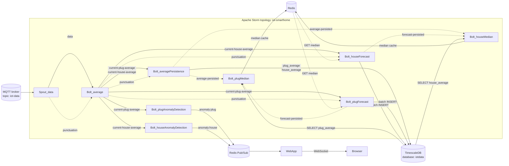

# Storm Smart Home Plus

Storm Smart Home Plus mô phỏng xử lý dữ liệu điện năng theo dataset DEBS 2014. Dữ liệu được replay từ CSV qua MQTT, xử lý bởi Apache Storm, lưu vào TimescaleDB, phát hiện bất thường qua Redis Pub/Sub và sử dụng Redis cache để phục vụ forecast.

## Kiến trúc

Topology được khai báo trong [MainTopo.java](storm-topology/src/main/java/com/storm/iotdata/MainTopo.java). Các window hiện tại là `1`, `5`, `15`, `60` và `120` phút. Mỗi window có một `Bolt_average` với parallelism `2`.



### Luồng xử lý

1. `Spout_data` subscribe MQTT topic `iot-data`, lọc bản ghi có `property = 1`, phát `data` và punctuation cho các window.
2. Mỗi `Bolt_average` gom dữ liệu theo `houseId`, tính plug/house average khi nhận punctuation, rồi phát `current-plug-average` và `current-house-average`.
3. `Bolt_plugAveragePersistence` và `Bolt_houseAveragePersistence` nhận average, ghi batch vào `plug_average`/`house_average`, rồi phát completion stream sau khi commit.
4. `Bolt_plugForecast` và `Bolt_houseForecast` nhận average, lấy median tương ứng từ Redis, tính forecast và ghi batch khi nhận punctuation từ `Bolt_average`. Sau khi commit, mỗi bolt phát completion stream.
5. Mỗi median bolt chờ đủ hai completion tương ứng: average persistence và forecast persistence. Sau đó query median theo `window_size`, `slice_index_in_day` và timestamp punctuation, rồi cập nhật toàn bộ kết quả vào Redis bằng pipeline.
6. Anomaly bolts duy trì rolling statistics, kiểm tra ngưỡng `20%` và publish cảnh báo lên Redis Pub/Sub. WebApp chuyển cảnh báo đến browser qua WebSocket.

## Cấu trúc chính

- `data-preprocess/`: chuẩn bị dữ liệu CSV.
- `mqtt-broker/`: cấu hình Mosquitto.
- `mqtt-publisher/`: replay CSV lên MQTT.
- `timescaledb/`: schema, dữ liệu mẫu và database dump.
- `storm-config/`: cấu hình Storm và ZooKeeper.
- `storm-topology/`: source code topology Apache Storm.
- `redis/`: Redis median cache-loader.
- `storm-exporter/`, `prometheus/`, `grafana/`: monitoring.
- `webapp/`: WebSocket server và giao diện nhận anomaly.

## Yêu cầu

- Docker và Docker Compose.
- JDK 8 trở lên và Maven.
- Node.js và npm nếu muốn replay dữ liệu bằng `mqtt-publisher`.

## Chạy hệ thống

### 1. Build topology và các image cần thiết

```bash
cd storm-topology
mvn install
cd ..

docker build -t stormexporter:v1 ./storm-exporter
docker build -t webapp:v1 ./webapp
docker build -t redis-cache-loader:v1 ./redis-cache-loader
```

### 2. Khởi động hệ thống

```bash
docker compose up -d
docker compose ps
```

TimescaleDB dùng database `iotdata` với tài khoản mặc định `postgres`/`postgres` và được khởi tạo từ `timescaledb/dump/iotdata.dump`.

### 3. Submit topology

```bash
docker exec nimbus storm jar \
  /apache-storm-2.5.0/Storm-IOTdata-1.0-SNAPSHOT-jar-with-dependencies.jar \
  com.storm.iotdata.MainTopo
```

Topology có tên `iot-smarthome`. Các địa chỉ chính:

- Storm UI: <http://localhost:8080>
- Grafana: <http://localhost:3000>
- WebApp: <http://localhost:3001>

### 4. Replay dữ liệu

```bash
cd mqtt-publisher
npm install
node src/main.js --broker localhost --port 1883 \
  --file ../data-preprocess/data-file/house-0-9_full_day-4.csv --topic iot-data
```

Các tùy chọn replay gồm `--speed-factor`, `--use-current-time`, `--qos` và `--retain`. Xem thêm [mqtt-publisher/README.md](mqtt-publisher/README.md).

## Cấu hình chính

Các cấu hình topology nằm trong `StormConfig.java`:

- MQTT: `tcp://mqtt-broker:1883`, topic `iot-data`.
- TimescaleDB: `jdbc:postgresql://timescaledb:5432/iotdata`.
- Redis: host `redis`, port `6379`.
- Redis anomaly channels: `anomaly:plug`, `anomaly:house`.
- Window sizes: `1`, `5`, `15`, `60`, `120` phút.
- Anomaly threshold: `20%`.

Nếu cần tạo lại database từ CSV, xem [timescaledb/README.md](timescaledb/README.md).
